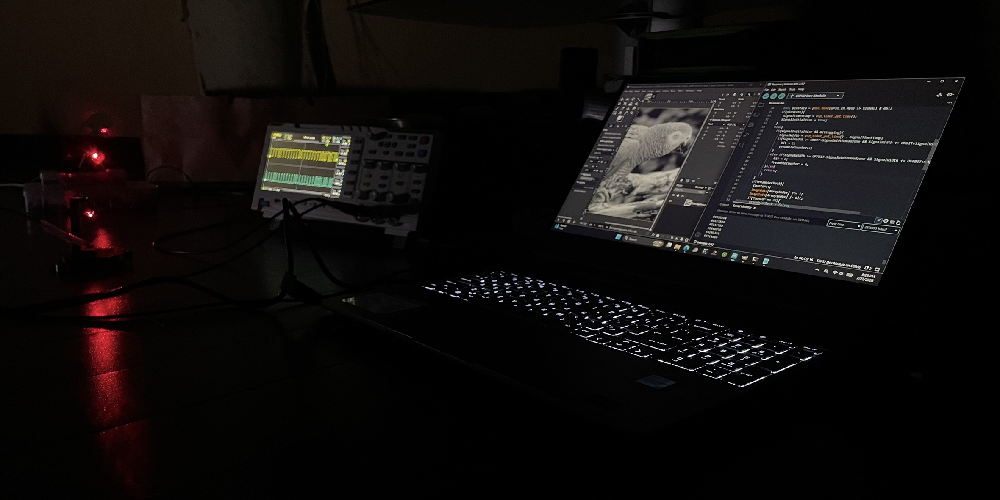
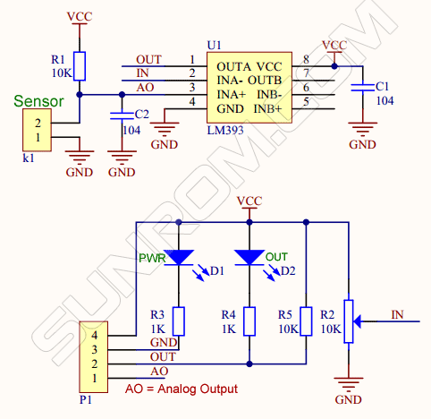
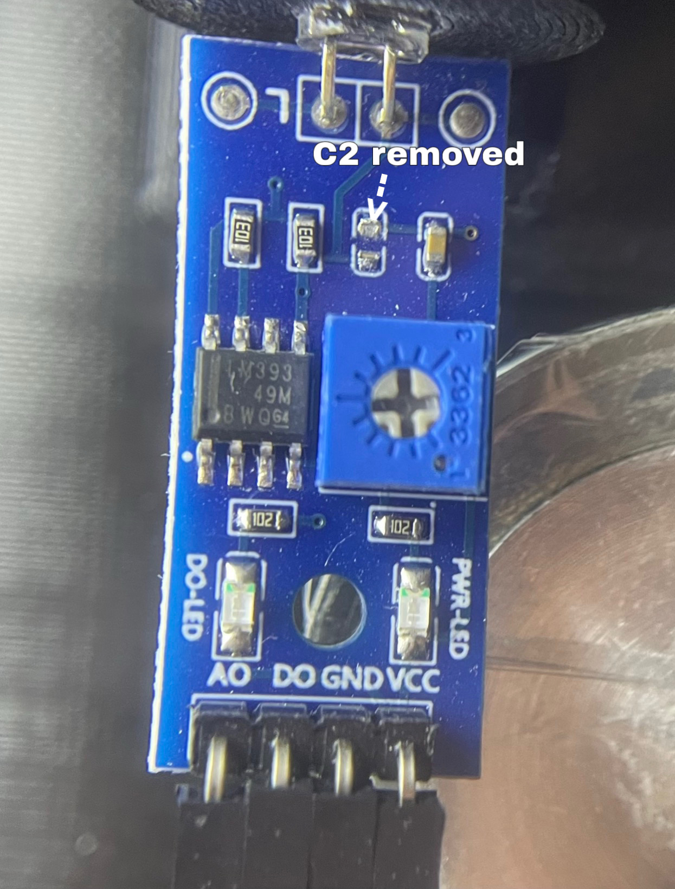
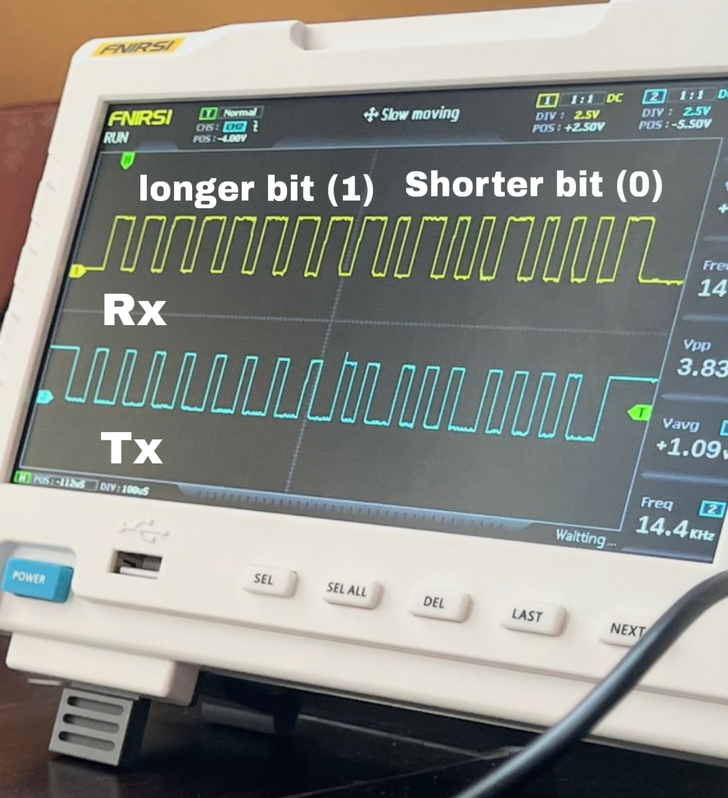
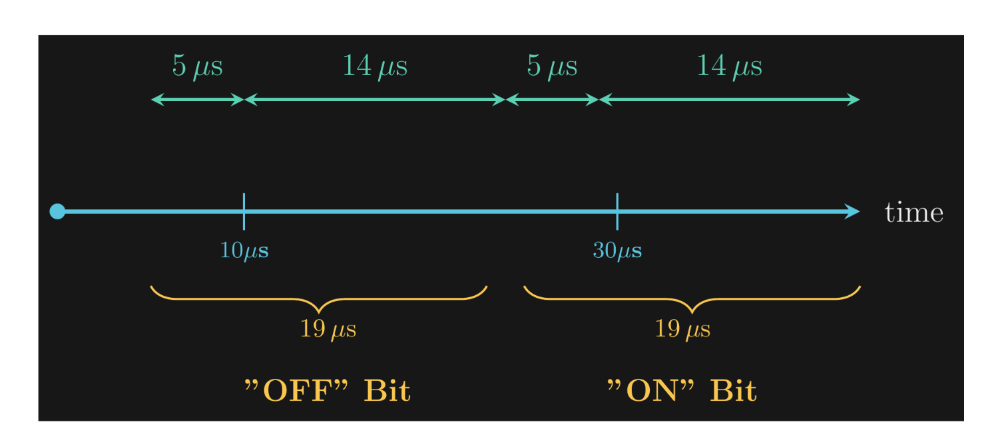

# Laser communication
A Free Space Optical communication system is a line of sight wireless technology that transmits high speed data using focused light beams through open air or outer space rather than physical fiber optic cables.

# Results



*Received image*

## Required materials
* microcontroller (Esp32 or faster is recommended)
* photodiode module (photodiode LM393 module used)
* laser diode

## Wiring
For the transmitter part, the laser diode should not be connected directly to the microcontroller output, as this would be too weak to drive the laser diode
so instead a low side NPN transistor switch is used for driving the [laser diode](http://hiletgo.com/ProductDetail/2010704.html).

On the receiver end, a photodiode module is used, it has a fast response time but not fast enough for this project so it must be modified.



*photodiode LM393 module schematic (ACTIVE LOW)*

To modify the photodiode module for a faster response time, capacitor C2 is removed to eliminate the unwanted RC low pass filter it forms with resistor R1, which would otherwise smooth out sharp signal rises and slow circuit performance. Additionally, adding a 330 ohm pull up resistor between the power supply and the analog pin (AO) places it in parallel with the onboard 10k resistor, dropping the high side resistance to approximately 320 ohm. By both removing the capacitive filtering and drastically lowering the resistance, this modification significantly decreases the RC time constant, enabling the module to detect rapid signal changes almost instantaneously.

This is done to the digital out (DO) pin too, as the parasitic capacitance of the circuit in combination with a huge resistor amplifies the RC time constant.
Adding a 1k pull up between supply and digital out(DO) gives a parallel resistance of approximately 980 ohms which reduces the RC time constant even further, but be aware that the LM393 IC relies on an open collector output meaning that when the comparator node is set to off it pulls down the pull up resistor and begins sinking current, and for safety the sinking current should be below 20mA, any more current will cause damage to the IC.



## Receiver calibration

```c++
uint32 SignalWidth = 30;//microseconds, an oscilloscope is used for calibrating the receiver side pulse width
```
Adjust this value if needed, although the default value is fine for most cases.
On the transmitter side, open the code file at the folder directory "SignalReference" and change the value of SIGNAL to the desired output pin

```c++
#define SIGNAL 18
```
connect the signal pin to the low side npn input with a current limiting resistor of around 1k, and the laser should begin flashing 
rapidly.
Aim the laser at the photodiode module and hook up an oscilloscope to the digital output (DO) of the photodiode module.

On the screen pulses should appear and it is normal to see that the signal width is shorter or longer than the set signal width. sometimes, a poorly calibrated photodiode might be set to a too low/high sensitivity that its either always on or off and this is normal, you just have to turn the blue potentiometer with a screwdriver in both directions until the signal has a width of the set signal width.


## Creating a bitmap image
Gimp image editing software used.

Import your image into GIMP, use the Crop Tool with a locked ⁠1:1⁠ aspect ratio to make it a square, optionally set the color mode to Grayscale, and scale the resolution to 128 pixels or less on each axis while keeping the proportions locked. Next, export the file as a ⁠.ppm⁠ into the ⁠ImageToBinary/InputImage/⁠ directory, making sure to select ASCII format (PPM Version 3) when prompted.Rename the exported ⁠.ppm⁠ file to ⁠.txt⁠, open it, and delete the GIMP comment on row 2 (e.g., ⁠# CREATED BY GIMP⁠). Finally, run ⁠main.exe⁠ (or compile ⁠main.cpp⁠) in ⁠ImageToBinary/InputImage/⁠, type in your ⁠.txt⁠ file's name when prompted in the console, and the program will generate a decimal file containing the average pixel color values inside the ⁠Output/⁠ directory.

## Importing the Decimal file into the Transmitter program

in transmitter program code set the ImageSize variable to the size of the included image (Not total pixels).

```c++
const uint8_t ImageSize = 128;
```
*line 25*

copy and paste all of the components that is inside the file existing in the folder directory “ImageToBinary/Output“ to the array

```c++
const uint8_t ImageData[ImageSize*ImageSize] = {};
```
*line 28*

## Receiving data
(while the transmitter is sending data be sure to not disrupt the signal as there is no error correction in this version of the code)

On the receiver side, when the transmission ends, data will be printed to the serial buffer which should then be copied and pasted inside the file in the folder directory “DecimalToImage/Input/“.

The ImageResolution variable must be set match your image size. 

```c++
int ImageResolution = 128;
```
*line 11*

Run the main.exe program or compile the main.cpp code. After completion a bitmap image will be saved to the output folder.

## PWM waveform & Custom Binary protocol


*The Received waveform shows a different framing protocol consisting of a Preamble, Counter Reset, and color data only.*

The signal waveform shows a received frame. The long bits represent 1, while the short bits represent 0.


### Custom Binary protocol


On the receiver end, the program receives incoming bits, where an "on" bit increments the preamble counter by 1, and an "off" bit resets it to 0.
When the preamble counter reaches a value of 9, it is reset back to 0, and a preamble check is flagged as true. As a result, the receiver begins shifting bits into the array, where the process is repeated until the array reaches its final index.

Counter reset bits are used in order to stop false logging initiation by resetting the preamble counter every "off" bit. The preamble check conditional requires 9 successive "on" bits for it to be flagged as true, whereas the bit framing protocol only sends a maximum of 9 consecutive "on" bits at a time(ideally). Therefore, it is used for flagging the preamble check with certainty in order to minimize logging errors.

### Bit classification



According to the diagram, the pulse width of a transmitted pulse is classified as an "on" or "off" bit. During reception, the obtained pulse width passes through a modifiable range for categorization. The classifer conditional does not rely on strict values. rather, a range is used for minimizing errors that may arrise from signal inconsistencies. However, the intervals of the bit classifiers must not overlap for the reciever end to function as intended. Furthermore, the intervals do not neccesseraliy have to operate on a symmetric range (the range's left-hand and right-hand width with respect to the theortical bit's duration, equal), as during operation, signal analysis has shown that at most times jitter only adds onto the theoretical pluse width and not any less. hence, the addition of this feature.

## License
[MIT](https://github.com/MansoorAlmaleki/Laser-communication/blob/f93b1685b51eef905da93d90d014dedf51ae5748/LICENSE)

